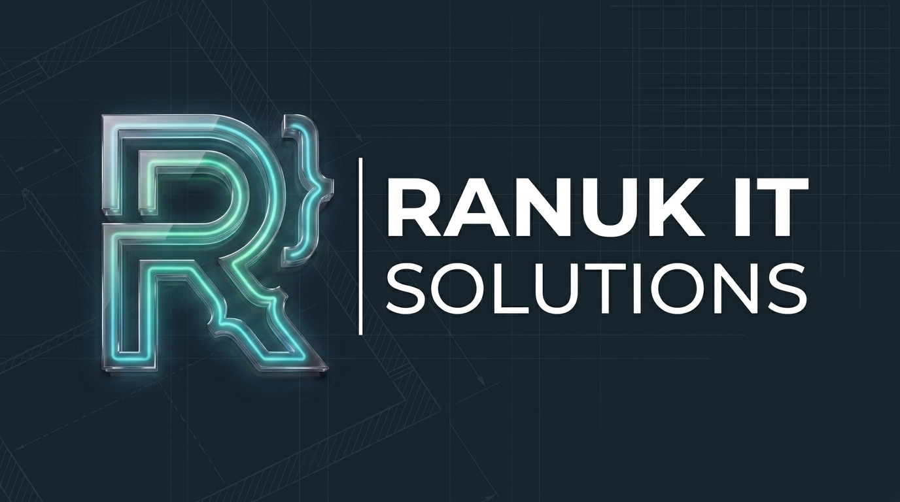
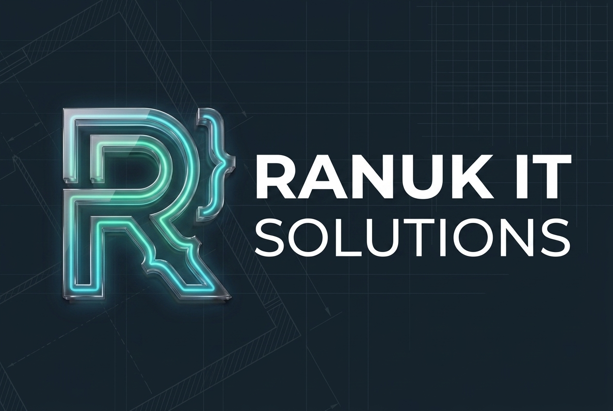
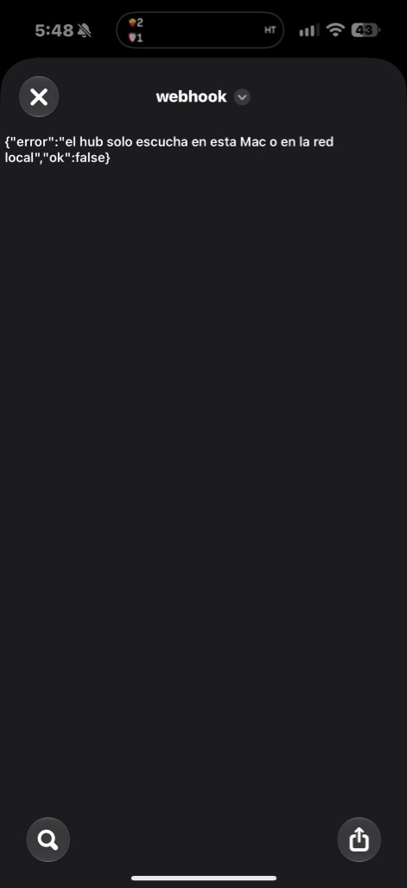

<p align="center">
  
</p>

<p align="center">
  
</p>

<h1 align="center">RANUK BIOSPAN 5.0</h1>
<h3 align="center">Autonomous Physiological Recovery, Autonomic Strain & Longevity Healthspan Engine</h3>

<p align="center">
  <em>Plataforma autónoma y gratuita de telemetría biométrica, análisis de longevidad celular y coaching fisiológico asistido por IA personal. Integración nativa directa con <strong>Xiaomi Watch S4 (Mi Fitness Cloud)</strong>, <strong>Apple Health</strong> y <strong>Telegram Mini App (TMA)</strong>.</em>
</p>

<p align="center">
  
  
  
  
  
</p>

---

## 🔬 Fundamentación Científica y Fisiológica

Ranuk BioSpan implementa modelos matemáticos abiertos basados en literatura médica y fisiología del ejercicio revisada por pares, proporcionando una alternativa 100% gratuita, privada y auto-hospedada a los ecosistemas cerrados por suscripción:

1. **Puntaje de Recuperación Autonómica (Bio-Recovery %)**:
   - Basado en el balance parasimpático derivado de la variabilidad de la frecuencia cardíaca (**VFC / HRV RMSSD** en milisegundos) y la desviación frente a la línea base móvil de 30 días de la frecuencia cardíaca en reposo (**RHR**) (*Shaffer & Ginsberg, 2017; Frontiers in Public Health*).
   - Incorpora la arquitectura de sueño y eficiencia restauradora nocturna para modular la capacidad de asimilación de carga del día.

2. **Carga Cardiovascular y Mecánica (Autonomic Day Strain 0.0 – 21.0)**:
   - Basado en el modelo de impulso de entrenamiento **TRIMP** (*Training Impulse*, Banister & Calvert, 1975; Morton et al., 1990) con escala logarítmica ponderada sobre 5 zonas de frecuencia cardíaca:
     - **Zona 1 (50–60% FC Máx)**: Recuperación activa ($1.0\times$).
     - **Zona 2 (60–70% FC Máx)**: Base mitocondrial y oxidación de lípidos ($1.5\times$).
     - **Zona 3 (70–80% FC Máx)**: Umbral aeróbico ($2.2\times$).
     - **Zona 4 (80–90% FC Máx)**: Umbral anaeróbico y lactato ($3.4\times$).
     - **Zona 5 (90–100% FC Máx)**: Consumo máximo de oxígeno $\text{VO}_2$ pico ($5.0\times$).
   - Ponderación muscular añadida para sesiones de fuerza e hipertrofia.

3. **Arquitectura y Calidad de Sueño (Restorative Ratio)**:
   - Desglose poligráfico en 4 fases de sueño (*AASM Standards; Walker, 2017*):
     - **Sueño Profundo (SWS / Fase 3)**: Reparación tisular, síntesis de hormona de crecimiento y limpieza glinfática cerebral.
     - **Sueño REM**: Consolidación de memoria, plasticidad sináptica y equilibrio neuroquímico.
     - **Sueño Ligero (Fases 1 y 2)**: Transición metabólica.
     - **Vigilia y Micro-despertares**: Cuantificación de despertares y cálculo de la deuda de sueño acumulada.

4. **Biomarcadores de Longevidad Celular (PhenoAge & BioSpan Index)**:
   - Cálculo de la **Edad Biológica** y **Ritmo de Envejecimiento (Pace of Aging)** basado en marcadores funcionales y cardiorrespiratorios (*Levine et al., 2018; Belsky et al., 2020 - DunedinPACE*):
     - Capacidad aeróbica estimada ($\text{VO}_2\text{ Max}$).
     - Frecuencia cardíaca mínima en reposo ($\text{RHR}$).
     - Porcentaje de sueño restaurador ($\text{REM} + \text{SWS}$).
     - Consistencia circadiana interdiaria.
     - Volumen semanal en Zona 2 y entrenamiento de fuerza.
     - Volumen ambulatorio (pasos diarios) y tono vagal autónomo ($\text{HRV}$).

5. **AI Biometric Coach Inteligente**:
   - Router fisiológico híbrido que analiza las desviaciones biométricas en tiempo real y ofrece recomendaciones accionables a través de **DeepSeek-V3**, **Groq (Llama-3.3-70B LPU)** o **Google Gemini 2.5 Flash**.

---

## 📱 Capturas de Pantalla (Telegram Mini App)

<p align="center">
  
  
</p>

---

## ⚡ Características Principales

- **Conector Nativo Mi Fitness Cloud (`hlth.io.mi.com`)**:
  - Extractor directo con cifrado **RC4** y autenticación segura con cuenta Xiaomi.
  - Soporte de inicio de sesión con **Email/Teléfono + Contraseña** (con validación de **código 2FA por correo/SMS** y captcha).
  - Soporte de inicio de sesión con **Código QR oficial de Xiaomi** o link de 1 clic para aprobar desde el iPhone.
  - Auto-descubrimiento regional multizona (`US`, `DE`, `SG`, `CN`, `RU`, `I2`).
  - Extracción histórica automática de los **últimos 35 días** de sueño, frecuencia cardíaca continua, FC en reposo, estrés, $\text{SpO}_2$, pasos, calorías y entrenamientos.
- **Webhook Universal para iOS & Apple Health**:
  - Endpoint HTTP compatible con la app **Atajos (Shortcuts)** de iOS para sincronización automática de métricas al apagar la alarma.
- **Telegram Mini App (TMA) Oscura OLED**:
  - Interfaz táctil ultra moderna optimizada para iPhone y Android en Telegram.
  - Círculos de telemetría interactivos con renderizado de vectores SVG y gradientes de neón.
  - Gráficos interactivos en Chart.js con selector de 7 y 14 días.
  - Hypnograma interactivo de fases de sueño y curva diurna de estrés 24 horas.
- **Journal de Hábitos con Correlación Estadística**:
  - Registro de hidratación, magnesio, luz solar matutina, cafeína tardía, cena pesada y estrés laboral, con estimación del impacto en el Recovery del día siguiente.
- **Briefing Matutino en Telegram**:
  - Servicio automatizado vía `launchd` / `cron` que envía a primera hora un resumen ejecutivo a tu bot de Telegram con botón directo para abrir la Mini App.

---

## 🏛️ Arquitectura del Sistema

```
                       ┌─────────────────────────┐
                       │     Xiaomi Watch S4     │
                       └────────────┬────────────┘
                                    │ Bluetooth Low Energy (BLE)
                                    ▼
                       ┌─────────────────────────┐
                       │ Mi Fitness App (iPhone) │
                       └────────────┬────────────┘
                                    │ HTTPS (Mi Cloud Sync)
                                    ▼
                       ┌─────────────────────────┐
                       │ Xiaomi Cloud Services   │
                       │   (hlth.io.mi.com)      │
                       └────────────┬────────────┘
                                    │ RC4 Encrypted Auth + Polling
                                    ▼
   ┌──────────────────────────────────────────────────────────────┐
   │             Ranuk BioSpan Core Engine (Host Mac)             │
   │                                                              │
   │  ┌─────────────────────────┐    ┌─────────────────────────┐  │
   │  │   xiaomi_cloud.py       │    │   biospan_health.py     │  │
   │  │ (RC4 Crypto + Extractor)│    │ (Physiological Formulas)│  │
   │  └────────────┬────────────┘    └────────────┬────────────┘  │
   │               │                              │               │
   │               ▼                              ▼               │
   │        SQLite Database (~/.ranukita/health/whoop.db)         │
   │                               │                              │
   │               ┌───────────────┴───────────────┐              │
   │               ▼                               ▼              │
   │   aiohttp Server (:8788)           AI Biometric Coach        │
   │  (REST API + Telegram WebApp)    (DeepSeek / Groq / Gemini)  │
   └───────────────┬───────────────────────────────┬──────────────┘
                   │                               │
                   ▼ Cloudflare Tunnel             ▼
       ┌───────────────────────┐       ┌───────────────────────┐
       │ https://hub.ranuk.dev │       │  Telegram Bot Dispatch│
       │       /whoop          │       │    (@ranuklaw_bot)    │
       └───────────────────────┘       └───────────────────────┘
```

---

## 🚀 Instalación y Puesta en Marcha

### Requisitos Previos
- Python 3.10 o superior.
- Reloj inteligente Xiaomi Watch S4 (o cualquier wearable sincronizado con la app **Mi Fitness**).
- Conexión a internet para el túnel seguro y llamadas de IA.

### 1. Clonar el Repositorio
```bash
git clone https://github.com/RanuK12/Ranuk-Whooping.git
cd Ranuk-Whooping
```

### 2. Crear Entorno Virtual e Instalar Dependencias
```bash
python3 -m venv .venv
source .venv/bin/activate
pip install -r requirements.txt
```

### 3. Configuración de Variables de Entorno (`.env`)
Crea un archivo `.env` en la raíz del proyecto:
```env
# Claves de IA (usa al menos una para el Coach Fisiológico)
DEEPSEEK_API_KEY=tu_clave_deepseek
GROQ_API_KEY=tu_clave_groq
GOOGLE_API_KEY=tu_clave_gemini

# Telegram Bot (Opcional, para notificaciones matutinas y TMA)
TELEGRAM_BOT_TOKEN=tu_token_de_bot
TELEGRAM_CHAT_ID=tu_chat_id
```

### 4. Iniciar el Servidor
```bash
python3 -m src.ranuk_biospan.server
```
El servidor escuchará por defecto en `http://127.0.0.1:8788/whoop`.

---

## ⌚ Conexión de tu Xiaomi Watch S4

1. Abre la aplicación **Mi Fitness** en tu smartphone.
2. Ve a **Perfil ➔ Ajustes ➔ Sincronizar con la nube** y asegúrate de que esté habilitado.
3. Abre la Mini App en el navegador o en Telegram (`/whoop`).
4. Haz clic en **☁️ Conectar Mi Fitness**:
   - **Opción A**: Ingresa tu correo/teléfono y contraseña de Xiaomi (acepta código 2FA si lo tienes activo).
   - **Opción B**: Genera el código QR oficial y escanéalo con tu cuenta Xiaomi o toca el botón para autorizar directamente desde el navegador de tu móvil.
5. El sistema descargará automáticamente los últimos 35 días de historial real y recalibrará tus basales de recuperación y longevidad.

---

## 🔄 Automatización Matutina (macOS launchd)

Para que el sistema sincronice automáticamente cada mañana a las 07:30 y te despache el resumen matutino con botón interactivo en Telegram:

```bash
cp scripts/com.ranuk.biospan-brief.plist ~/Library/LaunchAgents/
launchctl load -w ~/Library/LaunchAgents/com.ranuk.biospan-brief.plist
```

---

## 🧪 Pruebas Unitarias

Para ejecutar el set de validación fisiológica y de cifrado:
```bash
python3 -m unittest discover -s tests -v
```

---

## 📄 Licencia

Distribuido bajo la Licencia **MIT**. Consulta el archivo [`LICENSE`](LICENSE) para más detalles.

Copyright (c) 2026 **Ranuk IT Solutions** — Desarrollado por Emilio Ranucoli.
